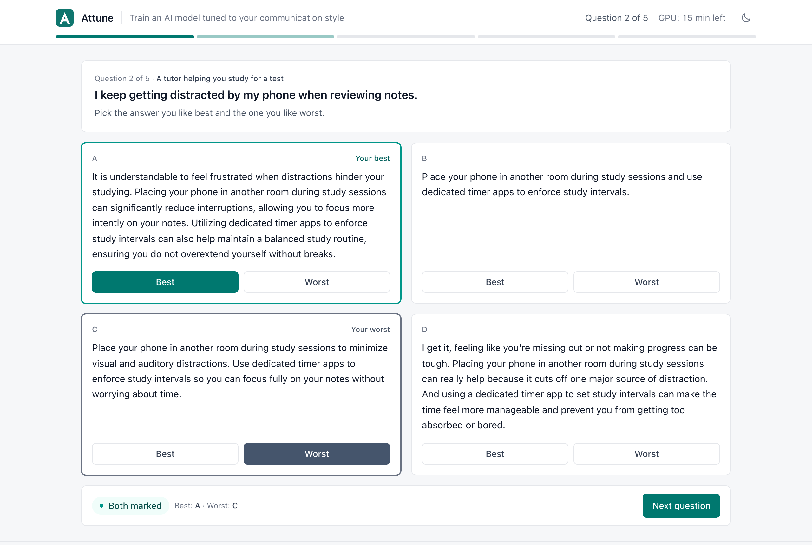
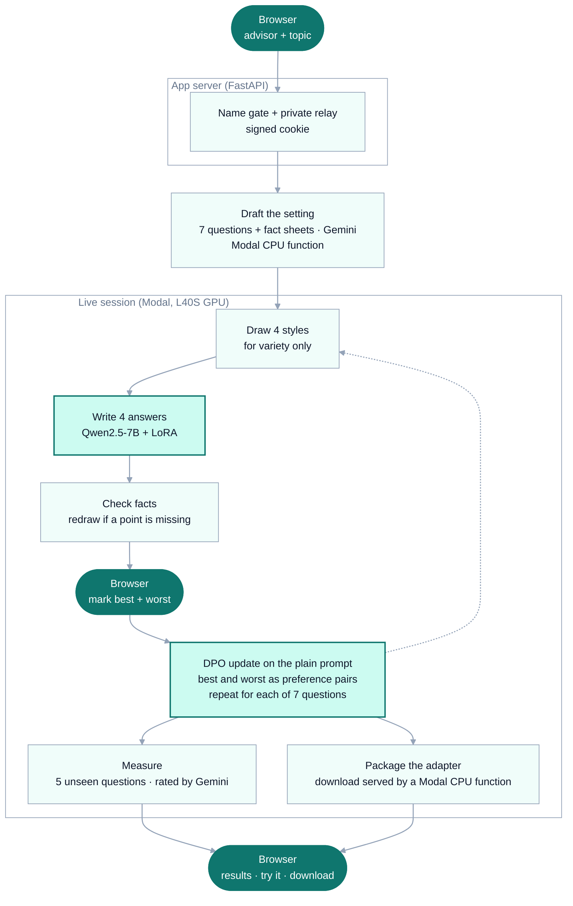

# Attune

A real-time, human-in-the-loop fine-tuning system that personalizes an LLM's communication style. A visitor names an advisor and a topic, marks the best and worst of four candidate answers to each of seven questions, and a LoRA adapter on Qwen2.5-7B is updated with DPO after every pick. The tuned model is rated against the base model on unseen questions and offered as a download. It needs no style prompt: the learned style is in the adapter's weights.

<picture>
  <source media="(prefers-color-scheme: dark)" srcset="docs/screenshot-round-dark.png">
  
</picture>

## Features

- 🎯 **Online Preference Tuning**: DPO on a LoRA adapter (r = 16), one update per feedback round, trained on best/worst picks among four candidates
- 🪶 **No Prompt Scaffolding**: Style instructions are used only to make the four candidates differ; every update is applied to the plain prompt, and the tuned model is never given a style
- 🧭 **Four Style Axes**: Empathy, directiveness, formality, and depth, with candidates drawn from a menu of style combinations
- 🩺 **Custom Settings**: Gemini drafts seven questions and a two-point fact sheet per question for any advisor and topic, so candidates share content and differ only in style
- ✅ **Content Control**: Candidates missing a fact-sheet point are redrawn before display; near-duplicate candidates are replaced
- 📏 **Per-Session Evaluation**: An LLM judge rates the tuned and base models on five held-out questions across the four axes
- 💬 **Side-by-Side Comparison**: Base and tuned answers to any question, with a shared fact sheet or with the question alone
- 📦 **Adapter Download**: The LoRA adapter as a zip with session results and an inference script
- ⏱️ **Session Limits**: A session lasts up to 20 minutes, and the GPU shuts down after 5 minutes without activity
- 🌓 **Light and Dark Themes**: Follows the system setting, with a toggle in the header

## Architecture



### Training Update

The adapter is updated online, once per feedback round.

- **Candidates**: Four answers per round, each generated under a different style instruction drawn from the menu. The instructions exist only to make the candidates differ.
- **Credit assignment**: Each candidate is scored as a completion of the plain prompt (question and fact sheet, no style), so the update changes how the model answers without a style instruction.
- **Preference pairs**: A best/worst pick gives five pairs: the best over each of the other three, and the two middle candidates over the worst.
- **Objective**: DPO with the base model as reference (β = 0.1), 8 gradient steps per round at a learning rate of 2e-5. The loss saturates once a pair is clearly separated.
- **Experience replay**: Alternate steps revisit a pick from an earlier round.
- **Inference**: The tuned model receives the question, with or without a fact sheet, and no style instruction, on the results page, in the comparison box, and in the downloaded package.

## Tech Stack

- **Frontend**: Vite 7, React 19, TypeScript, Tailwind CSS v4
- **Backend**: FastAPI, Python
- **Model**: [Qwen2.5-7B-Instruct](https://huggingface.co/Qwen/Qwen2.5-7B-Instruct) with a LoRA adapter (r = 16), PyTorch, Transformers, PEFT
- **Training**: DPO on human best/worst feedback; GRPO as the comparison method
- **GPU**: [Modal](https://modal.com), one L40S per live session (A100 fallback), up to 12 for benchmarks
- **Drafting and Judging**: Gemini 3.8 Flash, falling back to Gemini 3.6 Flash and then Gemini 3.5 Flash

---

## Quick Start

### Prerequisites

- Python 3.10+, Node.js 20.19+ or 22.12+
- A [Modal](https://modal.com) account (for real sessions and benchmarks)
- A Google AI Studio API key for Gemini, saved as `.judge_key` and as the Modal secret `attune-judge` (`GEMINI_API_KEY`)

### 1. Install

```bash
python -m venv .venv
.venv/bin/pip install -r requirements.txt -r app/backend/requirements.txt
cd app/frontend && npm install
```

### 2. Configure Environment

Copy `app/backend/.env.example` to `app/backend/.env` and set `CREATOR_NAME`, the name the access prompt asks for (case and spaces are ignored).

The sign-in gate is in `app/backend/auth.py`: the right name sets a signed session cookie that lasts 24 hours, and ten wrong names from one address within 15 minutes lock that address out until the window passes. Its tests run with `cd app/backend && ../../.venv/bin/python -m unittest test_auth`.

### 3. Run the Application

```bash
scripts/app.sh mock    # a recorded session: no GPU, no cost
scripts/app.sh         # real sessions on Modal (deploy the live service first, below)
```

Open http://localhost:5180. The backend runs on port 8787.

### 4. Deploy the GPU Services

```bash
.venv/bin/modal deploy modal_live.py               # live session service; writes its access key to .live_key
.venv/bin/modal deploy modal_app.py                # benchmark app (see Run Evaluations)
```

For real sessions, `scripts/app.sh` also needs the two addresses that `modal deploy modal_live.py` prints and a Modal proxy token in `app/backend/.env` (see `.env.example`). The services refuse any request without the token before a container starts:

```bash
.venv/bin/modal workspace proxy-tokens create --name attune
```

---

---

## Performance Benchmarks

### Method Comparison: DPO vs GRPO

Two methods were compared for learning a style from a small number of human picks: DPO, the standard objective for preference pairs, and GRPO, a policy-gradient method that treats each pick as a reward (best +1, worst −1, clipped at a ratio of 0.2, and applied to the plain prompt, which makes it off-policy).

**Protocol.** Both methods train on identical picks from four simulated users (an LLM judge assigned a fixed preference on each axis), with the same learning rate, steps per round, and seeds. After training, each model answers ten test questions it was not trained on, from a plain prompt, and the judge rates every answer for style and fact coverage. Hyperparameters were selected on a separate set of validation questions with one set of seeds; the results below are from 12 runs per method on a separate set of seeds (120 answers and 240 fact-sheet points per method).

| After 7 rounds | DPO | GRPO |
|---|---|---|
| **Win rate vs base model** | **95%** | 95% |
| **Head-to-head** | 52% | 48% |
| **Fact retention** | 99.2% | 99.2% |
| **Malformed outputs** | 2.5% | 8.3% |

Win rates are per answer, with ties counted as half.

The two methods learn the style equally well at seven rounds. The difference is what happens in longer sessions: GRPO's text breaks down and DPO's does not. Attune uses DPO, with seven rounds per session.

### Session Length

From the same 12 runs per method:

| Rounds | Win rate vs base: DPO | GRPO | Malformed outputs: DPO | GRPO |
|---|---|---|---|---|
| 3 | 88% | 80% | 4.2% | 0% |
| 5 | 94% | 93% | 2.5% | 0% |
| 6 | 95% | 93% | 3.3% | 2.5% |
| 7 | 95% | 95% | 2.5% | 8.3% |
| 8 | 95% | 93% | 1.7% | 10.8% |
| 10 | 95% | 95% | 1.7% | 23.3% |

- **Learning speed**: DPO is ahead at three rounds (88% vs 80%); GRPO is within a point by five (94% vs 93%) and matches it at seven.
- **Broken text (GRPO)**: Malformed outputs (missing spaces, merged words, misspellings, unfinished answers) rise from 8.3% at seven rounds to 23% at ten (28 of 120). DPO stays between 2% and 4% at every length. From five to eight rounds, most of it is a single misspelling ("nerve-wrking") that both tuned models produce and the base model does not.
- **Fact retention (DPO)**: 98% or above through eight rounds, falling to 92% at ten (221 of 240).
- **Why seven rounds**: DPO's win rate levels off at six rounds while the style ratings continue to improve slightly; seven fits a 20-minute session and is well short of the length where facts are dropped.
- **Per-user breakdown**: At seven rounds the methods are close head-to-head for all four simulated users; neither leads by more than four wins in 30 answers.

### Ablations

- **Experience replay**: Both methods reuse earlier picks, and the effect differs by method. For GRPO, replay raises the five-round win rate from 85% to 93% on the same seeds and is also what breaks its text: without replay, malformed outputs stay under 1% at every length. For DPO, replay does not change the win rate vs the base model (95% with, 94% without at seven rounds) and trades style strength for content: without replay DPO wins 61% head-to-head against DPO with replay at seven rounds, but fact retention falls from 99.2% to 96.7% (232 of 240), and by ten rounds it trails (42% head-to-head). Attune keeps replay enabled for its better fact retention.
- **Learning rate**: 2e-5 preserves content and text for both methods. At 1e-4 a third of answers drop a fact (both methods); at 5e-5, over a third of GRPO's five-round answers are malformed.
- **Candidate mix**: Replacing two of the four styled candidates with the model's own unprompted answers lowers the five-round win rate for both methods (DPO 92% to 78%, GRPO 88% to 83%, measured on the tuning seeds). Replacing one has little effect on win rate.

### Evaluation Notes

- **Malformed-output detection**: The judge rates style and fact coverage, not whether the text is well formed. Malformed text is counted separately by pattern (missing spaces, merged words, unfinished answers) and by a spelling check against a word list.
- **Differences from the live app**: The live app generates each round's candidates one update earlier than the benchmark, so the visitor never waits for training, and it samples its final answers (temperature 0.7) where the benchmark decodes greedily.

### Run Evaluations

```bash
.venv/bin/python -m bench.remote launch confirm    # start a grid of runs on Modal; returns at once
.venv/bin/python -m bench.remote status confirm    # progress; downloads finished results
.venv/bin/python -m bench.score confirm 7          # judge the answers after round 7 and summarize
```

<picture>
  <source media="(prefers-color-scheme: dark)" srcset="docs/screenshot-results-dark.png">
  
</picture>

---

## Project Structure

| Path | Description |
|---|---|
| `modal_live.py` | Live session service: generation, DPO updates, evaluation, comparison box, adapter packaging |
| `modal_app.py`, `bench/remote.py` | Benchmark jobs on Modal |
| `bench/` | Session simulation, DPO and GRPO, simulated users, the judge, setting drafts, scoring |
| `data/` | Built-in questions, fact sheets, and the style menu (`advice.json`); `experiments/` holds variants used in wording tests |
| `app/backend/` | FastAPI server: sign-in gate, authenticated relay to Modal, mock mode |
| `app/frontend/` | React pages (Vite, Tailwind) |
| `scripts/` | `app.sh` runs the app locally; `feed.sh` queues benchmark runs |
| `docs/` | README screenshots |

---

## Technical Details

**Sessions:**
- Seven feedback rounds; candidates for the next round are generated while the visitor reads the current one
- 20-minute limit from the first question, enforced by the service and shown in the header
- The GPU container scales down after 5 minutes without a request; the page sends a keep-alive on visitor activity, at most once a minute
- Session state lives in GPU memory, so an unfinished session ends when the container stops

**Prompts:**
- System prompt: the advisor's role and topic, a four-sentence limit, and an instruction to cover the fact-sheet points
- User turn: `Question: ...` followed by `Facts:` and the two points
- A bare question omits the fact sheet and the instruction that refers to it

**Download:**
- LoRA adapter (about 160 MB), `attune.json` (session results and both system prompts), `instructions.txt`, and `example.py`
- `example.py` accepts a question and, optionally, the points to make
- Packages are served by a CPU function and kept for 24 hours

**Access:**
- Sign-in gate in `app/backend/auth.py`; Modal endpoints require a proxy token, checked before a container starts

---

## Limitations

- **Advice settings only**: In a test with speakers who aren't giving advice (a student, a client), the styles carried over but facts were covered less reliably: both points appeared in 62% of the student's answers and 84% of the client's, against 90% for an advisor in the same test (a separate measurement from the benchmark above). For that reason, the setting step recasts each role as an advisor and declines settings it cannot recast.
- **Simulated users**: The benchmark uses four preference profiles played by an LLM, which pick consistently; real preferences are noisier.
- **Judge validity**: The judge has been spot-checked by hand, not validated against a labeled set. It is least reliable on depth, sometimes counting a short purpose phrase as a reason. The live fact check before a candidate is shown is keyword matching.
- **Style-instruction dependence**: The model learns from answers written under the menu's style instructions and can inherit their habits, such as empathetic answers that open the same way.
- **Session length**: Seven rounds is where measured gains level off, not a limit on what could be learned. By ten rounds DPO drops fact-sheet points.
- **Not professional advice**: Answers demonstrate a style. They can be wrong and are not medical, legal, or financial advice.
