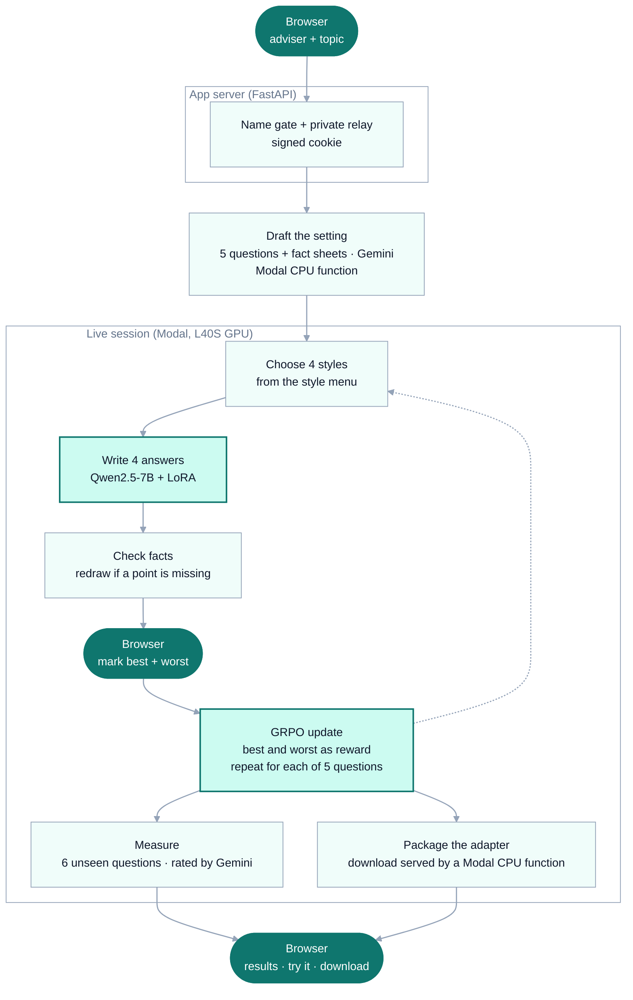

# Attune

Attune fine-tunes a 7B language model live on one person's feedback, so it learns how they like an adviser to speak to them. You say who is speaking to you and about what ("my doctor explaining my test results"), mark the best and worst of four answers to each of five questions, and get back a model trained on your picks, which you can download and run yourself.

<picture>
  <source media="(prefers-color-scheme: dark)" srcset="docs/screenshot-round-dark.png">
  
</picture>

## Features

- 🎯 **Live RLHF**: GRPO on a LoRA adapter, with your best and worst picks as the reward; one update per question, about five minutes for a session
- 🧭 **Four style scales**: empathy, directiveness, formality and depth, each answer drawn from a menu of style combinations
- 🩺 **Any adviser, any topic**: Gemini turns your description into five questions and a two-point fact sheet for each, so every answer gives the same advice and only the style differs
- ✅ **Content check**: an answer missing a fact-sheet point is redrawn before you see it; near-identical answers are replaced
- 📏 **Measured result**: a judge model rates your tuned model on six questions it was not trained on, beside the standard model
- 💬 **Try it**: ask your own question and compare the standard model's answer with yours
- 📦 **Download**: the adapter as a zip, with your results and a script to run it
- 🌓 **Light and dark themes**

## Results

Benchmarked with simulated users played by the judge model (each given a fixed set of preferences), five feedback rounds per run, rated on unseen questions:

| Comparison | Result |
|---|---|
| GRPO against the untouched model | **96%** answer-level win rate (113 wins, 4 ties, 3 losses) |
| GRPO against DPO, 28 matched runs | **59%** win rate (122 wins, 88 ties, 70 losses) |
| Scales on the wanted side | 87% for GRPO, 72% for DPO |
| Run-to-run variance in scales learned | **73% lower** for GRPO |
| Answers adding advice not on the fact sheet | 26% for GRPO, 22% for DPO |

Ties count as half a win. GRPO leads on the four standard simulated users (59% head to head) and most clearly on a user who cares about only two scales (94% of those scales right, against 75%). It does not reduce additions: its answers add something not on the fact sheet slightly more often than DPO's. An earlier run had shown the opposite, because answers written in a style were cut at three sentences while DPO's could use four; with the same limit for both, that gap disappeared. In an earlier run with a user who picks the shortest answer, DPO, which trains on the text directly, shortened its answers further than GRPO. Every run and setting is recorded in [`TODO.md`](TODO.md).

<picture>
  <source media="(prefers-color-scheme: dark)" srcset="docs/screenshot-results-dark.png">
  
</picture>

## Architecture



**How the update works.** The model makes two choices for each answer: first a style line from the menu, then the answer written in that style. GRPO compares the four answers to one question, so the best pick's choices are reinforced and the worst's discouraged. The style choice is clipped as a single action (ratio 0.2), the wording is trained at 0.3 of that strength so the model doesn't settle on one stock phrase, and 30% of styles are drawn at random to keep exploring. The four styles in a round differ on at least two scales.

**Benchmark.** The same session code runs on Modal with a simulated user in place of the browser: the judge model, given a persona, picks best and worst. GRPO and DPO (trained on the same best-and-worst pairs) run on matched personas and seeds, and the judge rates each run's answers to unseen questions.

## Tech Stack

- **Frontend**: Vite 7, React 19, TypeScript, Tailwind CSS v4
- **Backend**: FastAPI, Python
- **Model**: [Qwen2.5-7B-Instruct](https://huggingface.co/Qwen/Qwen2.5-7B-Instruct) with a LoRA adapter (r 16), PyTorch, Transformers, PEFT
- **Training**: GRPO with human best/worst feedback; DPO as the baseline
- **GPU**: [Modal](https://modal.com), one L40S for live sessions, more for benchmarks
- **Drafting and judging**: Gemini 3.8 Flash, falling back to 3.6 Flash and then 3.5 Flash

---

## Quick Start

### Prerequisites

- Python 3.10+, Node.js 20.19+ or 22.12+
- A [Modal](https://modal.com) account (for real sessions and benchmarks)
- A Google AI Studio API key for Gemini, saved as `.judge_key` and as the Modal secret `attune-judge` (`GEMINI_API_KEY`)

### 1. Install

```bash
python -m venv .venv
.venv/bin/pip install -r requirements.txt -r app/backend/requirements.txt
cd app/frontend && npm install
```

### 2. Configure

Copy `app/backend/.env.example` to `app/backend/.env` and set `CREATOR_NAME`, the name the access prompt asks for (case and spaces are ignored).

### 3. Run the app

```bash
scripts/app.sh mock    # a recorded session: no GPU, no cost
scripts/app.sh         # real sessions on Modal (deploy the live service first, below)
```

Open http://localhost:5180. The backend runs on port 8787.

### 4. The GPU service and benchmarks

```bash
.venv/bin/modal deploy modal_live.py               # live session service; writes its access key to .live_key
.venv/bin/modal deploy modal_app.py                # benchmark app
.venv/bin/python -m bench.remote launch final      # start a set of runs; returns at once
.venv/bin/python -m bench.remote status final      # progress; downloads finished results
.venv/bin/python -m bench.judge compare final      # judge the runs' answers and summarise
```

---

## Project Structure

| Path | What it is |
|---|---|
| `bench/` | Session simulation, GRPO and DPO, simulated users, the judge, setting drafts |
| `data/` | Built-in questions, fact sheets and the style menu |
| `modal_live.py` | The live session service: generation, updates, results, try box, adapter packaging |
| `modal_app.py`, `bench/remote.py` | Benchmark jobs on Modal |
| `app/backend/` | FastAPI server: name gate, private relay to Modal, mock mode |
| `app/frontend/` | The pages (React, Vite, Tailwind) |
| `scripts/` | `app.sh` to run the app locally, `feed.sh` to queue benchmark runs |
| `docs/` | Screenshots |

## Limits

- Advice only. A test with speakers who aren't advising (a student, a client) kept the styles but lost content, so the setting step treats every setting as advice and declines ones that aren't.
- The judge rates style and content and has been spot-checked by eye, not against a full set of hand labels. It is loosest on depth, sometimes counting a short "to…" phrase as a reason. The live fact check before an answer is shown is keyword matching.
- Results depend on how each style line is worded, and a tuned model can still settle on one opening phrase.
- The answers demonstrate a style. They can be wrong and are not medical, legal or financial advice.
