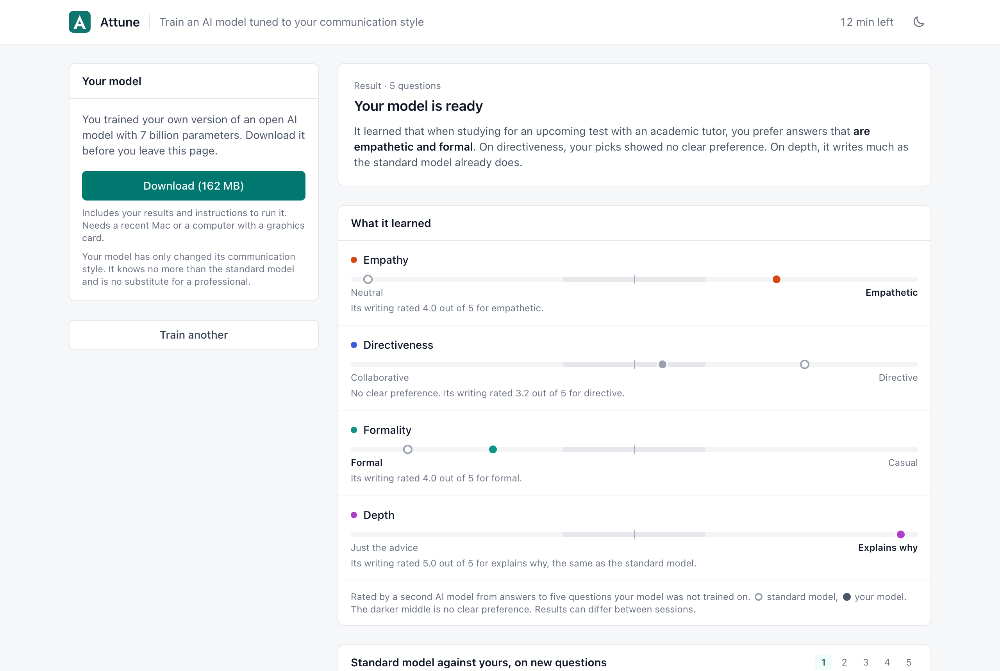

# Attune

Attune fine-tunes a 7B language model live on one person's feedback, so it learns how they like an advisor to speak to them. You say who is speaking to you and about what ("my doctor explaining my test results"), mark the best and worst of four answers to each of seven questions, and get back a model trained on your picks, which you can download and run yourself. The finished model needs no style prompt: ask it a plain question and it answers in the style it learned.

<picture>
  <source media="(prefers-color-scheme: dark)" srcset="docs/screenshot-round-dark.png">
  
</picture>

## Features

- 🎯 **Online preference tuning**: DPO on a LoRA adapter, trained on your best and worst picks, with one update per question
- 🪶 **No prompt scaffolding**: style instructions only make the four answers in a round differ. The training changes how the model answers a plain question, and the finished model is never given a style
- 🧭 **Four style scales**: empathy, directiveness, formality, and depth, each answer drawn from a menu of style combinations
- 🩺 **Any advisor, any topic**: Gemini turns your description into seven questions and a two-point fact sheet for each, so every answer gives the same advice and only the style differs
- ✅ **Content check**: an answer missing a fact-sheet point is redrawn before you see it; near-identical answers are replaced
- 📏 **Measured result**: a judge model rates your tuned model on five questions it was not trained on, beside the standard model
- 💬 **Try it**: ask your own question and compare the standard model's answer with yours, with both given the same points to make or with the question alone
- 📦 **Download**: the adapter as a zip, with your results and a script to run it
- ⏱️ **Twenty-minute sessions**: a session ends twenty minutes after its first question, with the time left shown, and the GPU stops about five minutes after a visitor walks away, which caps what one visit can cost
- 🌓 **Light and dark themes**

## Results

Attune trains on a person's picks while they wait, so its method has to learn from very little feedback and leave the writing intact. Two were compared: DPO, the standard method for tuning on preference pairs, and GRPO, a policy-gradient method that treats each pick as a reward.

Both were trained on the same picks from four simulated users (the judge model, each given a fixed set of preferences), with the same learning rate, steps per round, and seeds. After training, each model answers ten test questions it was not trained on, from a plain prompt with no style in it, and the judge model rates every answer.

| After seven rounds | DPO | GRPO |
|---|---|---|
| Win rate over the untouched model | **95%** | 95% |
| Head to head | 52% | 48% |
| Fact-sheet points kept | 99.4% | 99.4% |
| Malformed answers | 1.7% | 4.6% |

Win rates are per answer, with a tie counted as half, from 12 runs per method on seeds that played no part in choosing the learning rate or the mix of answers shown. Including the 12 runs used for tuning, they are 95% and 94% over the untouched model, and 52% to 48% head to head. Fact and malformed counts are over all 24 runs (480 fact-sheet points and 240 answers per method); on the 12 held-out runs alone, malformed answers were 2.5% for DPO (3 of 120) and 8.3% for GRPO (10 of 120), with 238 of 240 fact-sheet points kept by each.

The two learn the style equally well. They differ in what happens as a session gets longer: GRPO's writing breaks down and DPO's does not. Attune ships DPO, with seven questions.

| Rounds | Win rate over the untouched model: DPO | GRPO | Malformed answers: DPO | GRPO |
|---|---|---|---|---|
| 3 | 87% | 78% | 2.1% | 0% |
| 5 | 93% | 90% | 1.7% | 0.8% |
| 6 | 95% | 91% | 2.1% | 1.7% |
| 7 | 95% | 94% | 1.7% | 4.6% |
| 8 | 94% | 94% | 1.2% | 7.1% |
| 10 | 94% | 95% | 0.8% | 24% |

Over all 24 runs per method. What the runs showed:

- **DPO learns faster.** It is ahead after three rounds (87% against 78%) and five (93% against 90%); GRPO catches up by seven.
- **GRPO's text breaks in longer sessions.** Both methods reuse earlier picks in each update (experience replay), DPO by design and GRPO because it needs to: after five rounds GRPO's win rate was 93% with replay and 85% without, on the same seeds (DPO was not run without it). For GRPO the reuse has a cost. Each return to an earlier round pushes its worst answer down again, and the writing starts to fail: missing spaces, words run together, misspellings, answers that do not end. Without replay GRPO's malformed answers stayed under 1% at every length. DPO reuses picks the same way without that damage; its 1 to 2% is nearly all one misspelling ("nerve-wrking") that both tuned models produce and the untouched model never does.
- **DPO drops facts if pushed too far.** Through eight rounds it kept 99% of fact-sheet points; at ten it kept 96% (459 of 480).
- **Why seven.** DPO's win rate is flat from six rounds on, while the judge's style ratings still move a little toward the user's side each round. Seven is a session a careful reader can finish in twenty minutes, and it is well short of ten rounds, where facts are dropped.
- **Head to head by user.** At seven rounds the methods are level for three of the four simulated users; DPO is ahead for the fourth, the "kind professional" (29 wins to 15).
- **Learning rate.** 2e-5 kept both the content and the text. At 1e-4 a third of answers dropped a fact, for both methods; at 5e-5, five rounds left over a third of GRPO's answers malformed.
- **The model's own answers.** Replacing two of the four styled answers with the model's own unprompted answers learned worse for both methods (at five rounds, 78% against 92% over the untouched model for DPO, and 83% against 88% for GRPO): two styled answers do not give enough variety to choose between. Replacing one made little difference to the win rate.

The judge rates style and facts, not whether the text is well formed. Malformed text is counted separately in the scoring, by pattern (missing spaces, words run together, unfinished answers) and by a spelling check against a word list.

<picture>
  <source media="(prefers-color-scheme: dark)" srcset="docs/screenshot-results-dark.png">
  
</picture>

## Architecture


**How the update works.** Training happens online, with the adapter updated after every question during the session. Each round's four answers are written under four different style instructions drawn from the menu. The instructions are there only to make the answers differ: each answer is then scored as a reply to the plain question, with no style named. A pick gives five preferences (the best over each of the other three, and the two in between over the worst). For each one, DPO makes the preferred answer more likely as a plain answer and the other less likely, measured against the untouched model, and the push fades once the two are clearly apart. Every other step of an update goes back to an earlier round's pick, so each pick is used more than once. The tuned model is never given a style: on the results page, in the try box, and in the download, its prompt is the question, with or without the points to make, and nothing about how to say it.

**Benchmark.** The same session code runs on Modal with a simulated user in place of the browser: the judge model, given a persona, picks best and worst. DPO and GRPO are trained on the same best-and-worst picks, on matched personas and seeds, with the same learning rates tried for each. GRPO here is its clipped, group-relative update with the best answer rewarded and the worst penalized, credited to the plain prompt like DPO's; because the answers are written under style instructions and not sampled from the plain prompt, that is GRPO's objective used off-policy. A method's settings are chosen on held-out questions and one set of seeds, and the comparison is reported on test questions and fresh seeds. The live app differs from the benchmark in two ways: it writes each round's answers one update earlier, so the visitor never waits for training, and it samples its final answers where the benchmark writes them without randomness.

## Tech Stack

- **Frontend**: Vite 7, React 19, TypeScript, Tailwind CSS v4
- **Backend**: FastAPI, Python
- **Model**: [Qwen2.5-7B-Instruct](https://huggingface.co/Qwen/Qwen2.5-7B-Instruct) with a LoRA adapter (r = 16), PyTorch, Transformers, PEFT
- **Training**: DPO on human best/worst picks; GRPO as the method compared against it
- **GPU**: [Modal](https://modal.com), one L40S for live sessions (an A100 when none is free), more for benchmarks
- **Drafting and judging**: Gemini 3.8 Flash, falling back to 3.6 Flash and then 3.5 Flash

---

## Quick Start

### Prerequisites

- Python 3.10+, Node.js 20.19+ or 22.12+
- A [Modal](https://modal.com) account (for real sessions and benchmarks)
- A Google AI Studio API key for Gemini, saved as `.judge_key` and as the Modal secret `attune-judge` (`GEMINI_API_KEY`)

### 1. Install

```bash
python -m venv .venv
.venv/bin/pip install -r requirements.txt -r app/backend/requirements.txt
cd app/frontend && npm install
```

### 2. Configure

Copy `app/backend/.env.example` to `app/backend/.env` and set `CREATOR_NAME`, the name the access prompt asks for (case and spaces are ignored).

The sign-in gate is in `app/backend/auth.py`: the right name sets a signed session cookie that lasts 24 hours, and ten wrong names from one address within 15 minutes lock that address out until the window passes. Its tests run with `cd app/backend && ../../.venv/bin/python -m unittest test_auth`.

### 3. Run the app

```bash
scripts/app.sh mock    # a recorded session: no GPU, no cost
scripts/app.sh         # real sessions on Modal (deploy the live service first, below)
```

Open http://localhost:5180. The backend runs on port 8787.

### 4. The GPU service and benchmarks

```bash
.venv/bin/modal deploy modal_live.py               # live session service; writes its access key to .live_key
.venv/bin/modal deploy modal_app.py                # benchmark app
.venv/bin/python -m bench.remote launch confirm    # start a set of runs; returns at once
.venv/bin/python -m bench.remote status confirm    # progress; downloads finished results
.venv/bin/python -m bench.score confirm 7          # judge the runs' answers after round 7 and summarise
```

For real sessions, `scripts/app.sh` also needs the two addresses that `modal deploy modal_live.py` prints and a Modal proxy token in `app/backend/.env` (see `.env.example`). The services refuse any request without the token before a container starts:

```bash
.venv/bin/modal workspace proxy-tokens create --name attune
```

---

## Project Structure

| Path | What it is |
|---|---|
| `bench/` | Session simulation, GRPO and DPO, simulated users, the judge, setting drafts |
| `data/` | Built-in questions, fact sheets, and the style menu (`advice.json`); `experiments/` holds the copies used in wording tests |
| `modal_live.py` | The live session service: generation, updates, results, try box, adapter packaging |
| `modal_app.py`, `bench/remote.py` | Benchmark jobs on Modal |
| `app/backend/` | FastAPI server: name gate, private relay to Modal, mock mode |
| `app/frontend/` | The pages (React, Vite, Tailwind) |
| `scripts/` | `app.sh` to run the app locally, `feed.sh` to queue benchmark runs |
| `docs/` | Screenshots |

## Limits

- Advice only. In a test with speakers who aren't advising (a student, a client), the styles came through but content was covered less reliably: both points appeared in 62% of the student's answers and 84% of the client's, against 90% for an advisor in the same test (a separate measurement from the benchmark above). So the setting step keeps every session to advice: it recasts the role as someone advising you, and declines settings it can't recast.
- The judge rates style and content and has been spot-checked by eye, not against a full set of hand labels. It is loosest on depth, sometimes counting a short "to…" phrase as a reason. The live fact check before an answer is shown is keyword matching.
- Results depend on how each style line is worded. The model learns from answers written under those lines, so it can inherit their habits, such as empathetic answers that open the same way ("It can feel…").
- Seven rounds is where the measured gains level off, not a limit on what could be learned. Longer sessions were not better in the benchmark: by ten rounds DPO drops fact-sheet points.
- The answers demonstrate a style. They can be wrong and are not medical, legal, or financial advice.
